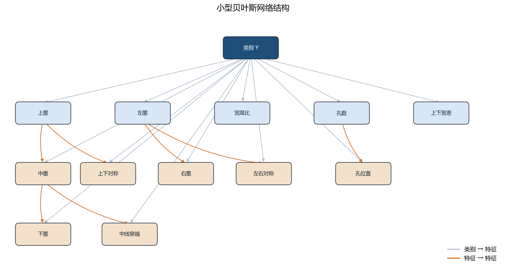
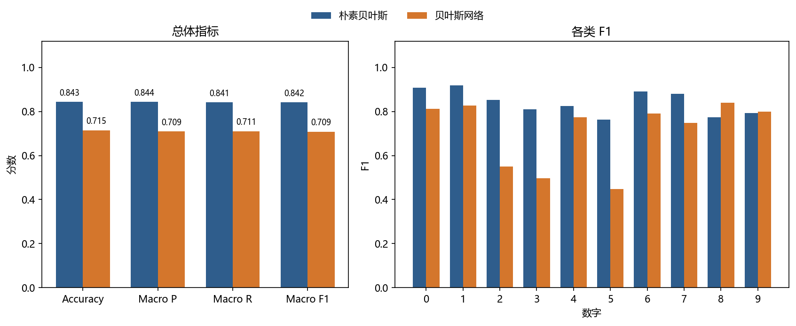
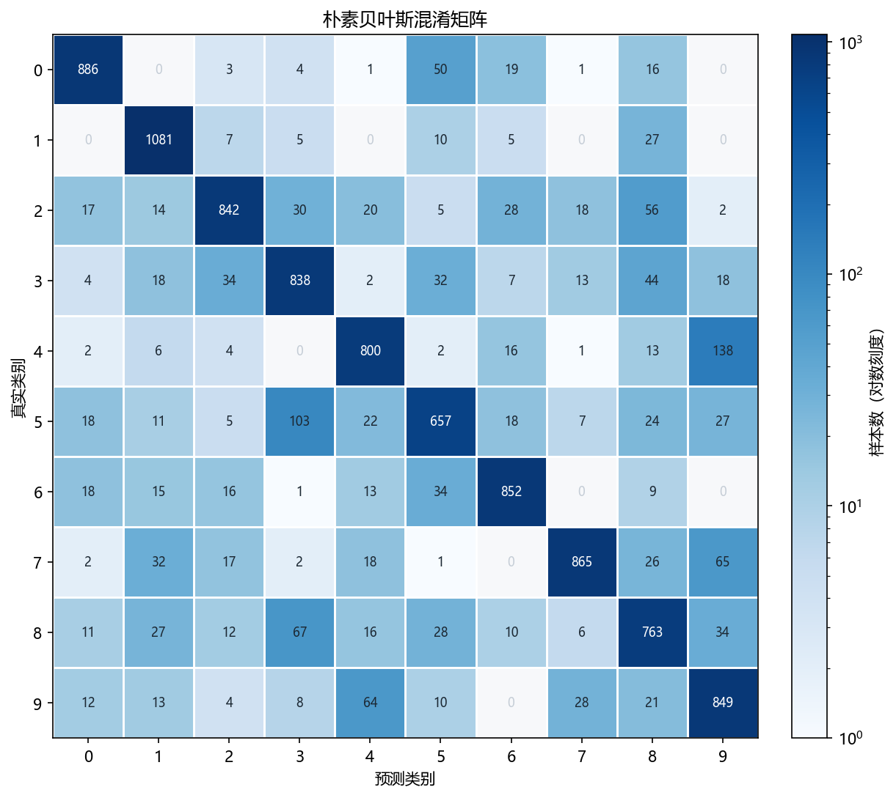
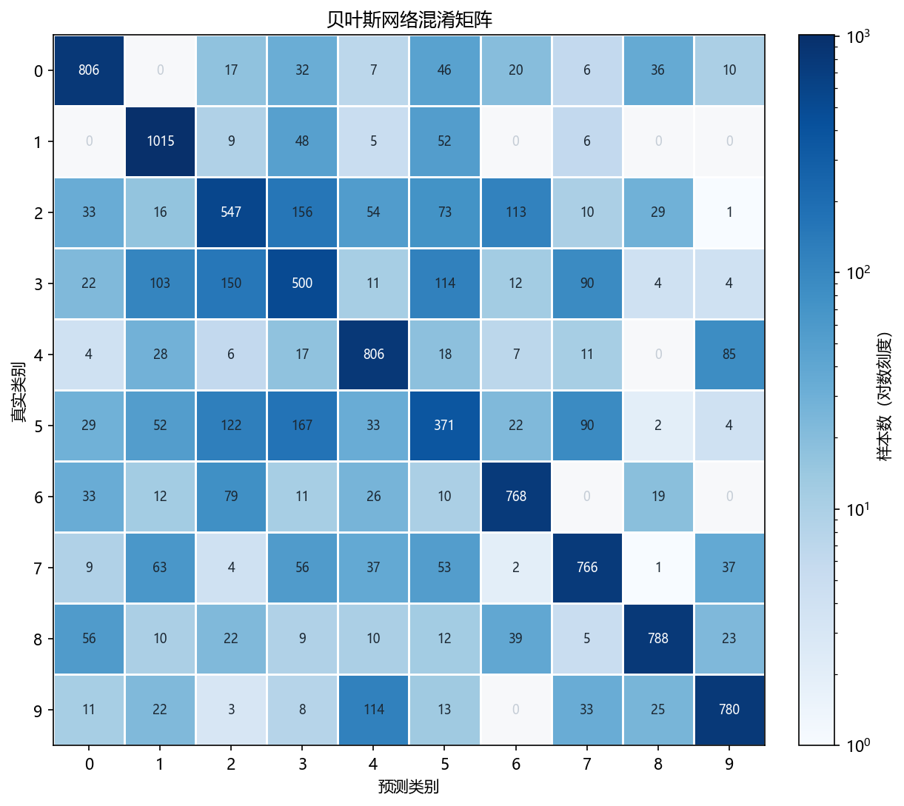
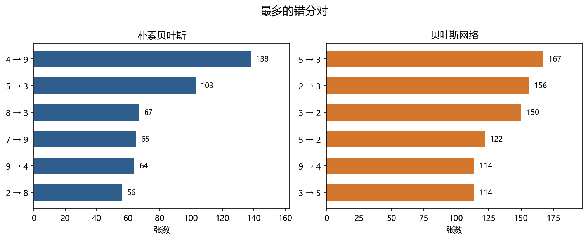
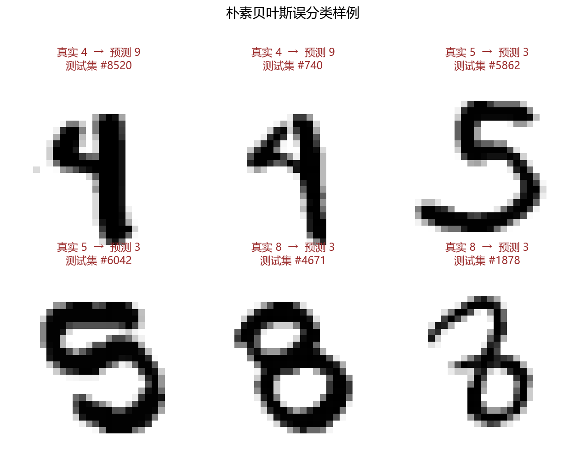
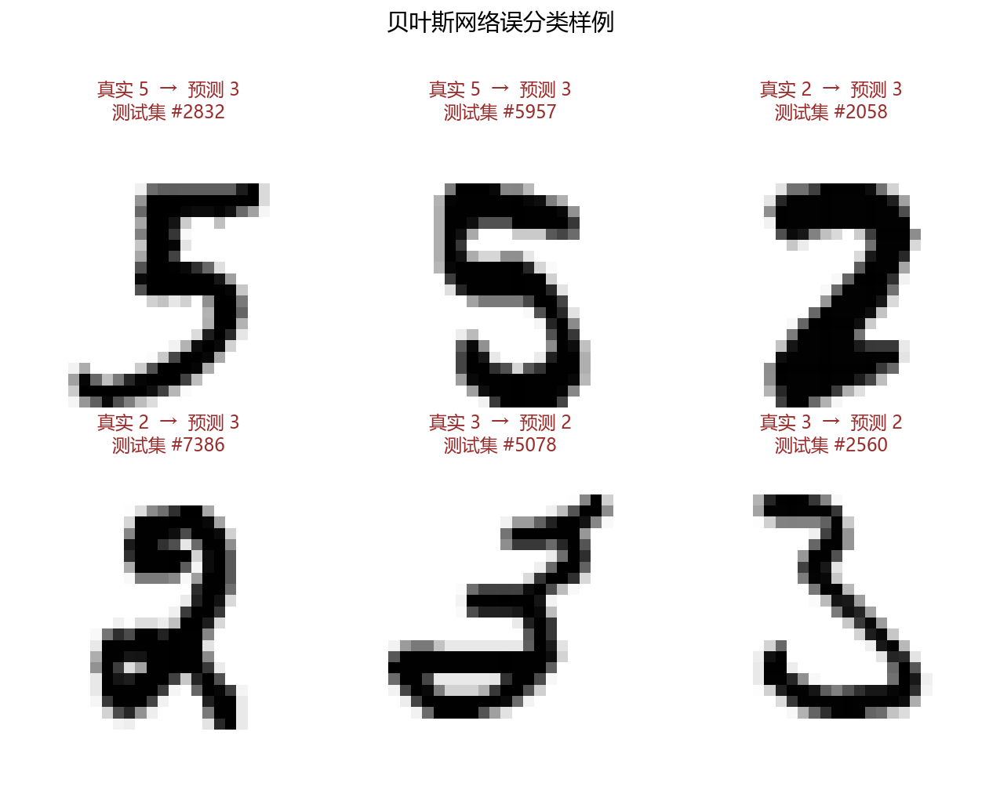

# 手写数字识别：朴素贝叶斯与小型贝叶斯网络

## 1. 总体设计

两个分类器都放在 `assignment2/`，类名和接口按课程协议写好，评测程序可以直接加载。先验、条件概率、平滑和预测都是自己实现的，没有调用现成的朴素贝叶斯或贝叶斯网络库。

```
assignment2/
├── naive_bayes.py     # NaiveBayesClassifier
├── bayes_net.py       # BayesNetClassifier 与 extract_features
├── main.py            # 读数据、训练、评估、出图
├── requirements.txt
├── results.json
├── figures/
└── report.md
```

数据是标准 MNIST：训练集 60,000 张，测试集 10,000 张，图像 28×28，像素 0–255。`main.py` 把 IDX 文件放到仓库根目录的 `assignment2-data/mnist/`。该目录已在 `.gitignore` 里，原始数据不进课程仓库。在 `assignment2` 目录下运行：

```bash
pip install -r requirements.txt
python main.py
```

读入后图像展平成 `(n, 784)`。两个模型共用这一输入，预处理都在模型内部完成，测试集不参与估计参数，也不用来改阈值。

| 项目 | 取值 |
| --- | --- |
| 平滑系数 α | 1.0（拉普拉斯平滑） |
| 朴素贝叶斯 | 像素 `> 128` 记为墨，否则为背景 |
| 贝叶斯网络 | 同样的墨迹阈值，再抽 12 个三档离散特征 |
| 分档边界 | 按训练集分布取整后写死，测试时不再改 |

朴素贝叶斯把 784 个像素当成给定类别后条件独立的二值特征。贝叶斯网络用少量几何特征代替像素，类别 `Y` 是根，另外手工加了 7 条特征之间的边。

## 2. 朴素贝叶斯

### 2.1 贝叶斯公式

像素二值化之后，一张图 `x = (x_1, ..., x_784)` 的后验满足

\[
P(y \mid x) \propto P(y) \prod_{j=1}^{784} P(x_j \mid y)
\]

预测类别是

\[
\hat{y} = \arg\max_y \left[ \log P(y) + \sum_{j=1}^{784} \log P(x_j \mid y) \right]
\]

784 次连乘会下溢成 0，所以只累加对数。实现时把它写成

\[
\log P(x \mid y)
= \sum_j \log P(x_j=0 \mid y)
+ \sum_j x_j \big( \log P(x_j=1 \mid y) - \log P(x_j=0 \mid y) \big)
\]

后一项是一次矩阵乘法。训练时按类别数像素为墨的次数，不逐张循环。

### 2.2 条件独立

给定数字之后，模型认为任意两个像素互不影响。真实笔画不是这样：一个像素为墨时，邻居通常也是墨。这个假设换来很少的参数。每个类别只保留 784 个“该像素为墨”的概率，再加 10 个先验。

### 2.3 平滑

类别 \(c\) 有 \(N_c\) 张图，其中第 \(j\) 个像素为墨的有 \(N_{c,j}\) 张。二值特征有两种取值，

\[
P(x_j = 1 \mid y = c) = \frac{N_{c,j} + \alpha}{N_c + 2\alpha}, \qquad
P(y = c) = \frac{N_c + \alpha}{N + 10\alpha}
\]

\(\alpha = 1\)。某一类里从未出现过的像素，概率是 \(1/(N_c+2)\)，不会把整张图的分数乘成 0。

## 3. 贝叶斯网络

### 3.1 选了哪些特征，为什么

MNIST 的字写在画布中央，四周有几行空白。把 28 行直接三等分，上下两档会被空白稀释，所以区域密度用字身所在的窗口。墨迹仍是像素 `> 128`。行号、列号从 0 起。

每个特征都是 3 档，取值 0、1、2。连续量的两道边界按训练集分布取整后固定。

| 特征 | 为什么用它 | 离散方式 |
| --- | --- | --- |
| 上墨 | 第 4–11 行的墨迹比例。7、9 上面重，1、4 上面轻 | `< 0.12`，`< 0.20`，其余 |
| 中墨 | 第 12–17 行。4、6 的横笔多在这里 | `< 0.16`，`< 0.24`，其余 |
| 下墨 | 第 18–25 行。4、9、7 下面轻，0、2 下面不轻 | `< 0.10`，`< 0.18`，其余 |
| 左墨 | 第 6–11 列。1 几乎没有左墨 | `< 0.12`，`< 0.22`，其余 |
| 右墨 | 第 16–21 列。3、5 的弧在右侧 | `< 0.14`，`< 0.24`，其余 |
| 宽高比 | 墨迹外接框的宽除以高。1 又瘦又高 | `< 0.62`，`< 0.85`，其余 |
| 左右对称 | 左半和右半镜像后有多一致 | `< 0.83`，`< 0.87`，其余 |
| 上下对称 | 上半和下半翻转后有多一致 | `< 0.82`，`< 0.86`，其余 |
| 孔数 | 封闭孔的个数。8 常有两个，0/6/9 常有一个，1/3/5/7 几乎没有 | `0`，`1`，`≥ 2` |
| 孔位置 | 孔在字高里的相对位置。9 靠上，6 靠下 | 无孔；`< 0.46`；其余 |
| 中线穿越 | 第 14 行从背景进入墨迹的次数。1 通常 1 次，0 和 6 通常 2 次 | `≤ 1`，`2`，`≥ 3` |
| 上下宽差 | 第 6–11 行的平均行宽减去第 18–23 行。7、9 上宽下窄，2、6 相反 | `< -1.2`，`< 1.5`，其余 |

孔这样数：多张图拼到一张带空白间隔的大图上，背景用 4 邻域做连通标记。和间隔相连的是字外面，剩下至少 4 个像素的块才算孔。背景用 4 邻域，是为了让斜向相接的笔画仍能把孔封住。`scipy.ndimage.label` 只做这块标记，条件概率表和预测不依赖贝叶斯网络库。

训练集上如果按 8 邻域去数笔画段，几乎每张图都只有一段，这个量和类别无关，所以没有用“连通域个数”，改用孔数和孔的位置表示拓扑。

### 3.2 结构

`Y` 是根，12 个特征都以 `Y` 为父节点。另有 7 条特征到特征的边。每个特征最多再加一个特征父节点，父节点总数不超过 2。没有隐藏变量，结构是手工定的，没有用结构学习。



灰箭头是类别指向特征，橙箭头是特征之间的依赖。只以 `Y` 为父节点的是上墨、左墨、宽高比、孔数、上下宽差。

| 边 | 含义 |
| --- | --- |
| 上墨 → 中墨 | 竖向笔画从上往下延续。上面有墨时，中间更常有墨 |
| 中墨 → 下墨 | 同一条延续。4、9 下面轻，0、2 下面不轻 |
| 左墨 → 右墨 | 一次书写的用笔轻重会同时出现在左右 |
| 左墨 → 左右对称 | 左边过重时，左右就不对称 |
| 上墨 → 上下对称 | 上边过重时，上下就不对称 |
| 孔数 → 孔位置 | 没有孔时，位置只能是“无”；有孔之后才分靠上还是靠下 |
| 中墨 → 中线穿越 | 中间没有墨迹，中线就不会被穿过 |

联合分布是

\[
P(y, F_1, \ldots, F_{12}) = P(y) \prod_{i=1}^{12} P(F_i \mid \mathrm{Pa}(F_i))
\]

### 3.3 条件概率表

训练时 12 个特征都能观察到，每个节点用频数估计，不需要 EM。三档特征的平滑是

\[
P(F_i = v \mid \mathrm{pa}) = \frac{N(\mathrm{pa}, v) + \alpha}{N(\mathrm{pa}) + 3\alpha}
\]

\(\alpha = 1\)。某组父节点取值很少见时，三档接近均匀，不会出现零概率。

预测时特征全部已知，对 10 个类别分别算

\[
\log P(y, F) = \log P(y) + \sum_i \log P(F_i \mid \mathrm{Pa}(F_i))
\]

取得分最大的类别。不需要变量消元或近似推理。

### 3.4 和朴素贝叶斯的关系

两个模型都把类别放在生成式的根上，都用拉普拉斯平滑，也都用对数分数预测。朴素贝叶斯相当于“类别连着 784 个像素，像素之间没有边”。这个网络把像素换成 12 个语义特征，并允许其中 7 对在给定类别之后仍然相关。参数从大约 `10 × 784` 个像素似然，变成若干张 `10 × 3` 或 `10 × 3 × 3` 的表。

## 4. 实验评估

60,000 张训练图全部用来估计参数。下面的指标都来自 10,000 张测试图。宏平均对 10 个类别等权，不按样本数加权。混淆矩阵的行是真实类别，列是预测类别。

### 4.1 四个指标，以及各类差在哪里

| 模型 | Accuracy | Macro Precision | Macro Recall | Macro F1 |
| --- | ---: | ---: | ---: | ---: |
| 朴素贝叶斯 | 0.8433 | 0.8441 | 0.8409 | 0.8416 |
| 贝叶斯网络 | 0.7147 | 0.7090 | 0.7107 | 0.7086 |



左图里，每个模型自己的四个宏指标几乎一样高：朴素贝叶斯都在 0.84 附近，贝叶斯网络都在 0.71 附近。测试集类别大体均衡，所以准确率和宏平均没有被某一类拉开。

右图才看出差别落在哪些数字上。朴素贝叶斯的各类 F1 都在 0.76 以上，1 最高（0.919），5 和 8 最低（0.764、0.773）。贝叶斯网络在 8 上更高，F1 为 0.839，9 也略高（0.799 对 0.793）；2、3、5 掉到 0.549、0.497、0.449。孔数把大多数 8 和没有孔的数字分开了，但 2、3、5 通常都没有封闭孔，12 个粗特征分不开它们的曲线。

| 数字 | NB 精确率 | NB 召回率 | NB F1 | BN 精确率 | BN 召回率 | BN F1 |
| ---: | ---: | ---: | ---: | ---: | ---: | ---: |
| 0 | 0.913 | 0.904 | 0.909 | 0.804 | 0.822 | 0.813 |
| 1 | 0.888 | 0.952 | 0.919 | 0.768 | 0.894 | 0.827 |
| 2 | 0.892 | 0.816 | 0.852 | 0.570 | 0.530 | 0.549 |
| 3 | 0.792 | 0.830 | 0.810 | 0.498 | 0.495 | 0.497 |
| 4 | 0.837 | 0.815 | 0.826 | 0.731 | 0.821 | 0.773 |
| 5 | 0.793 | 0.737 | 0.764 | 0.487 | 0.416 | 0.449 |
| 6 | 0.892 | 0.889 | 0.891 | 0.781 | 0.802 | 0.791 |
| 7 | 0.921 | 0.841 | 0.880 | 0.753 | 0.745 | 0.749 |
| 8 | 0.764 | 0.783 | 0.773 | 0.872 | 0.809 | 0.839 |
| 9 | 0.749 | 0.841 | 0.793 | 0.826 | 0.773 | 0.799 |

### 4.2 混淆矩阵

图里每个格子写的是张数。颜色用对数刻度：对角线有几百到一千张，若按线性上色，几十张的错分会淡到看不见。对数刻度让 4→9、5→3 这类格子也能看出来。0 留白。







朴素贝叶斯的错分比较散。最多的是 4→9（138）和回头的 9→4（64），然后是 5→3（103）、8→3（67）、7→9（65）、2→8（56）。1 几乎不往外漏，召回率 0.952，1081 张里只有零星分到 8 或 2。

贝叶斯网络的错分聚在 2、3、5。5→3 有 167 张，2→3 有 156 张，3→2 有 150 张，5→2 有 122 张，3→5 有 114 张。这五格加起来是 709 张，约占它全部错误的四分之一。9→4 仍有 114 张。8 的对角是 788，比朴素贝叶斯的 763 多，和右图里 8 的 F1 更高一致。

朴素贝叶斯，行是真实类别：

| 真实\预测 | 0 | 1 | 2 | 3 | 4 | 5 | 6 | 7 | 8 | 9 |
| ---: | ---: | ---: | ---: | ---: | ---: | ---: | ---: | ---: | ---: | ---: |
| 0 | 886 | 0 | 3 | 4 | 1 | 50 | 19 | 1 | 16 | 0 |
| 1 | 0 | 1081 | 7 | 5 | 0 | 10 | 5 | 0 | 27 | 0 |
| 2 | 17 | 14 | 842 | 30 | 20 | 5 | 28 | 18 | 56 | 2 |
| 3 | 4 | 18 | 34 | 838 | 2 | 32 | 7 | 13 | 44 | 18 |
| 4 | 2 | 6 | 4 | 0 | 800 | 2 | 16 | 1 | 13 | 138 |
| 5 | 18 | 11 | 5 | 103 | 22 | 657 | 18 | 7 | 24 | 27 |
| 6 | 18 | 15 | 16 | 1 | 13 | 34 | 852 | 0 | 9 | 0 |
| 7 | 2 | 32 | 17 | 2 | 18 | 1 | 0 | 865 | 26 | 65 |
| 8 | 11 | 27 | 12 | 67 | 16 | 28 | 10 | 6 | 763 | 34 |
| 9 | 12 | 13 | 4 | 8 | 64 | 10 | 0 | 28 | 21 | 849 |

贝叶斯网络：

| 真实\预测 | 0 | 1 | 2 | 3 | 4 | 5 | 6 | 7 | 8 | 9 |
| ---: | ---: | ---: | ---: | ---: | ---: | ---: | ---: | ---: | ---: | ---: |
| 0 | 806 | 0 | 17 | 32 | 7 | 46 | 20 | 6 | 36 | 10 |
| 1 | 0 | 1015 | 9 | 48 | 5 | 52 | 0 | 6 | 0 | 0 |
| 2 | 33 | 16 | 547 | 156 | 54 | 73 | 113 | 10 | 29 | 1 |
| 3 | 22 | 103 | 150 | 500 | 11 | 114 | 12 | 90 | 4 | 4 |
| 4 | 4 | 28 | 6 | 17 | 806 | 18 | 7 | 11 | 0 | 85 |
| 5 | 29 | 52 | 122 | 167 | 33 | 371 | 22 | 90 | 2 | 4 |
| 6 | 33 | 12 | 79 | 11 | 26 | 10 | 768 | 0 | 19 | 0 |
| 7 | 9 | 63 | 4 | 56 | 37 | 53 | 2 | 766 | 1 | 37 |
| 8 | 56 | 10 | 22 | 9 | 10 | 12 | 39 | 5 | 788 | 23 |
| 9 | 11 | 22 | 3 | 8 | 114 | 13 | 0 | 33 | 25 | 780 |

### 4.3 误分类样例

每张图都取自该错对里、模型把错误类别后验打得最高的样本。像素按原图最近邻放大，避免缩小时笔画被抹平。

朴素贝叶斯：



- `#8520`、`#740`，真实 4，预测 9。`#8520` 的上半是封口的，和 9 的上圈用到同一批黑像素；`#740` 上半是开口的，人眼更像 4，模型仍然给 9。开口这一下没有被当成一个整体：每个像素单独计数，上横和右竖在很多 9 里同样是黑的。4→9 共 138 张，9→4 共 64 张，是这个模型最大的一对。
- `#5862`、`#6042`，真实 5，预测 3。两张都有顶横和向右的弧，左侧相对空。5 和 3 的差别在左上是否收住、下方往哪边勾。像素独立之后，这些位置关系被拆开，5→3 有 103 张。
- `#4671`、`#1878`，真实 8，预测 3。`#4671` 两个圈都在，只是笔画很粗，右侧像素和 3 重合很多；`#1878` 写得松，上圈接近开口。模型没有“两个孔要同时出现”这条约束，8→3 有 67 张。这也是它在 8 上的 F1 低于贝叶斯网络的原因。

贝叶斯网络：



- `#2832`、`#5957`，真实 5，预测 3。两张都是看得清的 5：有顶横，右侧两段弯。5 和 3 通常都没有封闭孔，宽高比也接近。网络只能看到上、中、下和左、右落在哪一档，顶横和右侧双弧的差别进不了特征。5→3 有 167 张，是全表最大的一格。
- `#2058`、`#7386`，真实 2，预测 3。`#2058` 写得很黑，右半几乎连成一片；`#7386` 下半还有一个小圈，孔的位置靠近下方，和“无孔的 3”并不相同，但上、中、下三档墨迹仍和不少 3 落在同一组格子里。2→3 有 156 张，3→2 有 150 张。
- `#5078`、`#2560`，真实 3，预测 2。`#5078` 写得斜，整体被拉开，更接近 2 的走势；`#2560` 上下两段都向右开口。对这组三档特征来说，它们和 2 的上下宽差、中线穿越是同一档。

### 4.4 两个模型怎么比

准确率相差约 13 个百分点：0.8433 对 0.7147。网络预测时没有做近似，分数就是对数联合概率，所以差距来自特征，不来自推理。784 个像素留着笔画的细位置；12 个三值特征把一张图压进很少的格子，2、3、5 会掉进同一格。

网络并不是每一类都更差。8 的 F1 从 0.773 升到 0.839，9 的精确率从 0.749 升到 0.826。孔数和孔的位置是像素独立模型写不出来的整体约束。4 的召回率两边接近，0.815 和 0.821，但 4→9 在像素模型里有 138 张，在网络里有 85 张：开口的 4 和闭口的 9 对两边都难，像素模型更容易被上半的黑像素拉向 9。

像素模型适合作为高维二值特征上的基线。这个网络用来看哪些几何量在起作用，以及给定类别之后哪些量仍然相关。

## 5. 讨论与反思

先碰到的是数值和零概率。像素似然连乘会变成 0，空的计数格也会把一条路径乘没。两个模型都改成对数概率，条件概率都加 \(\alpha = 1\)。网络里父节点组合是“类别 × 3 档”，有的组合样本不多，平滑让这些格子保持一个小的正概率。

朴素贝叶斯的限制是条件独立。笔画是成片的，一个像素为墨时邻居通常也是墨。它仍能到 0.84，是因为同类数字在固定位置上的墨迹足够稳定，很多弱特征叠在一起，盖过了独立性带来的重复计数。它分不清的是必须看结构的情况：4 和 9 的开口，5 和 3 的左上横，8 的两个孔。`#4671` 就是一张孔都在、却被分成 3 的 8。

手工定结构时，父节点最多两个。边再多，计数表就变稀，所以只留了能讲清楚的 7 条：竖向墨迹的延续、左右用笔轻重、对称性从哪一侧被破坏、孔的位置依赖于有没有孔、中线穿越依赖于中部有没有墨。一开始想用连通域个数表示笔画，训练集上这个数几乎总是 1，后来换成孔洞。孔的检测还要选邻域：背景若也用 8 邻域，斜缝会把孔漏掉。

若继续做，朴素贝叶斯可以把像素分成 4 个灰度档，用来区分细笔画和粗笔画，而不是只留黑白。贝叶斯网络更值得加的是左上、右上、左下、右下四块墨迹，以及上、中、下三条扫描线的穿越次数。5 和 3 的差别就在左上有没有横、右侧有几段弧，现在的三档区域密度太粗。档数可以加到 4 或 5，父节点上限仍然守住。这些都还是手工特征和手工结构。

## 参考文献

1. LeCun, Y., Cortes, C., Burges, C. J. C. The MNIST Database of Handwritten Digits. http://yann.lecun.com/exdb/mnist/
2. 课程第 5 章，概率推理与贝叶斯准则；第 6 章，贝叶斯网络。拉普拉斯平滑和离散贝叶斯网络的条件概率表估计按课堂定义实现。
