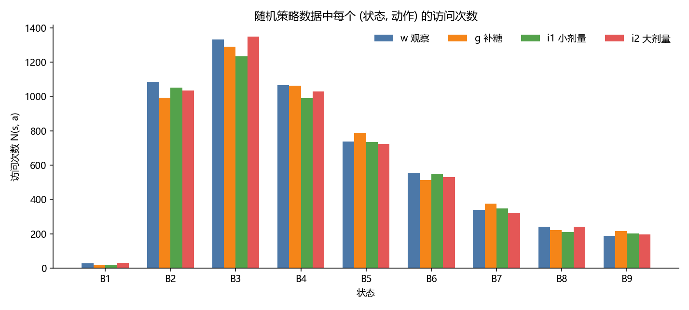
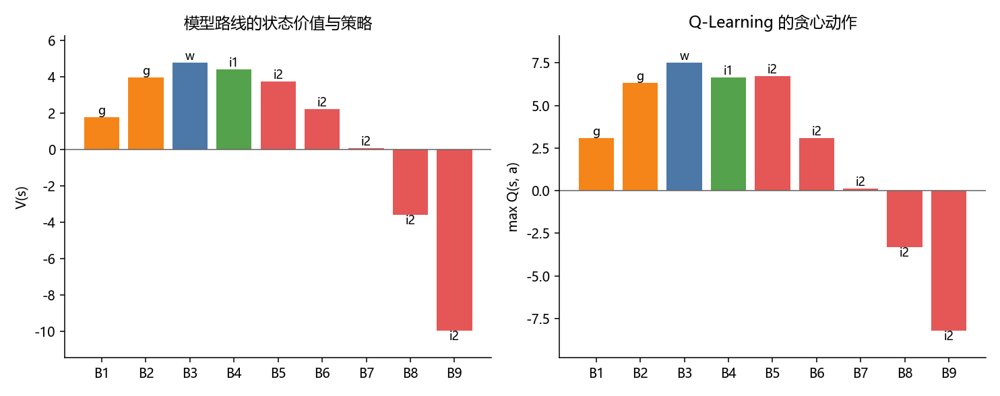
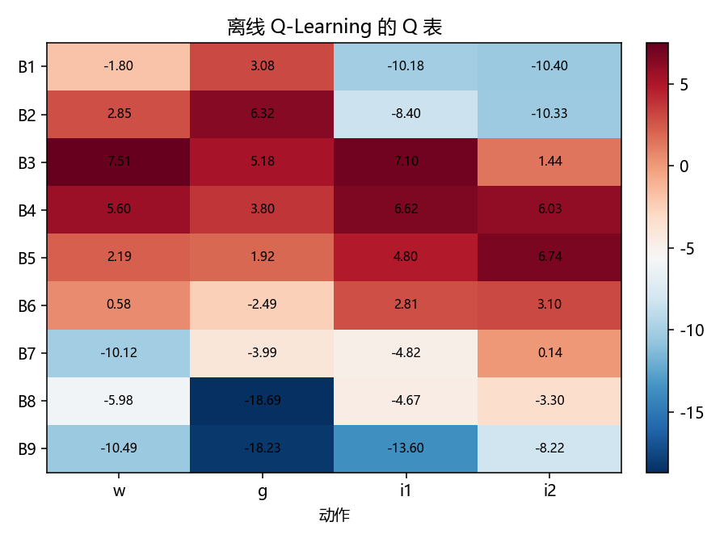
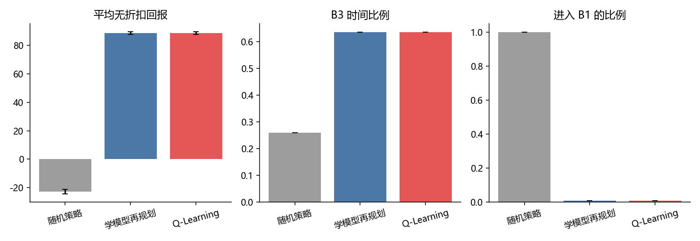
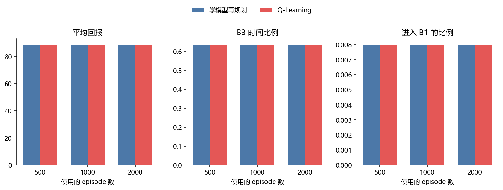
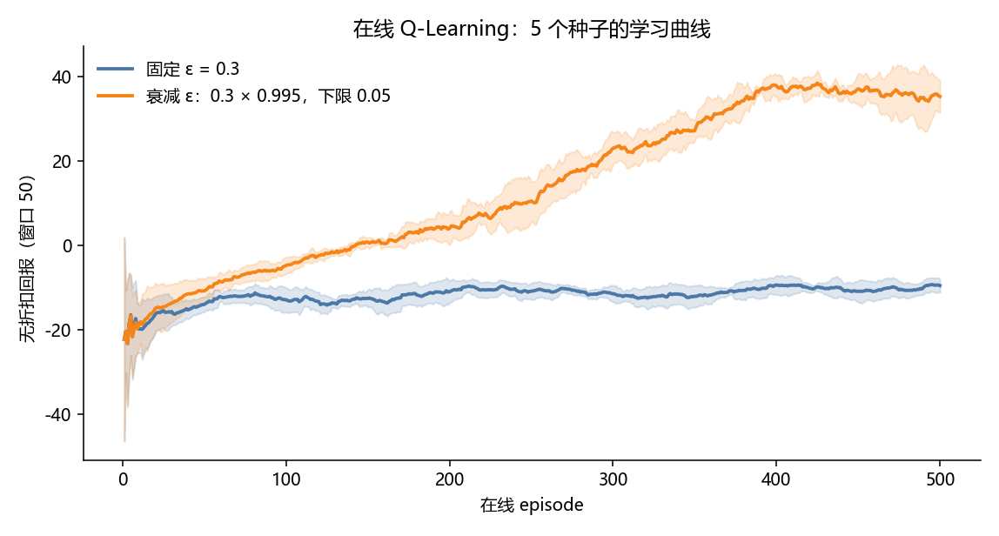
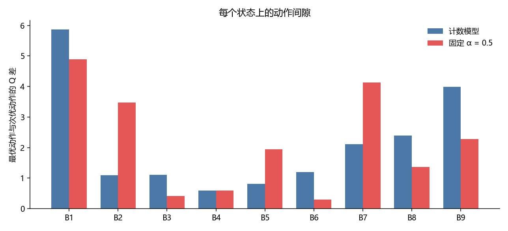
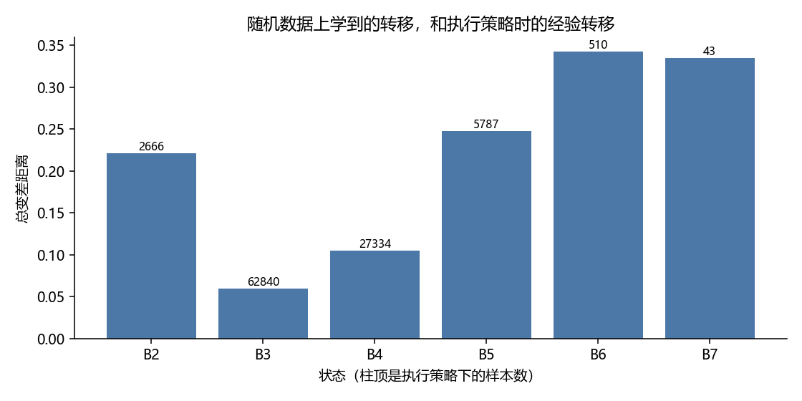
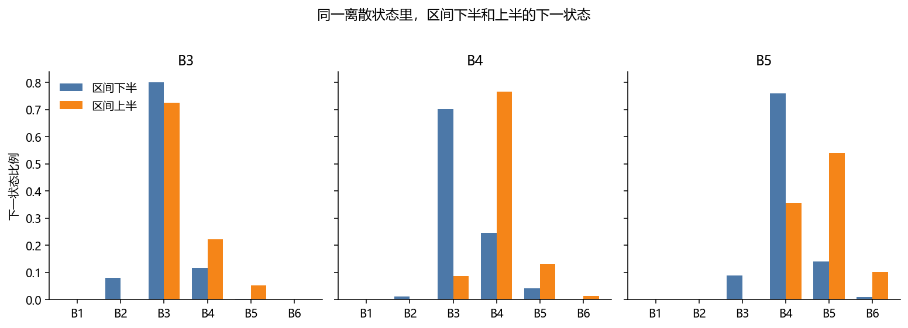

# 血糖调控：估计可以粗，动作不能错

两条路线在 2000 条数据上选出了同一张动作表，评估回报也逐条相同。作业要求的对比因此不是“谁的分数更高”，而是这条策略为什么在很差的数据上还能站住，以及它在什么地方其实是虚的。

结论先写在这里。随机策略平均 10.9 步就进入 B1，九个区间又把区间内的血糖和还没消退的进餐抹平。在这种数据上，B2–B7 的动作间隙仍然大于估计误差，所以计数模型、固定步长的 Q-Learning、以及把步长改成 \(1/N(s,a)\) 的对照，选出来的常用动作一样。模型搬到执行策略上以后，待得久的 B3 几乎没偏；偏得厉害的是 B5、B6，而策略在那里停不久。真正没被九个格子写出来的，是 B4 内部：同一剂小剂量胰岛素，区间下半有七成进入 B3，区间上半只有不到一成。

## 1. 总体设计

模型路线先数转移和奖励，再做价值迭代。Q-Learning 不建模型，按轨迹顺序更新 Q 表。状态是 B1–B9，动作是 `w`、`g`、`i1`、`i2`，\(\gamma = 0.9\)。两个智能体只消费五元组，不读真实血糖，也不读进餐残留。后面第 5 节用到这两项，只出现在评估脚本里。

```
assignment3/
├── model_based.py
├── q_learning.py
├── main.py
├── analysis.md
├── requirements.txt
├── results.json
├── figures/
└── report.md
```

`glucose_env.py` 和 `sanity_check.py` 放在上一级目录，不提交。在仓库根目录运行：

```bash
pip install -r assignment3/requirements.txt
python sanity_check.py
python assignment3/main.py
```

训练数据是 `collect_random_episodes(n_episodes=2000, seed=2026)`，共 21825 步。评估用种子从 50000 起的 500 条环境，和训练流不重合。回报是每步奖励直接相加。B3 时间比例是决策步开始时处于 B3 的步数除以总步数。进入 B1 的比例是回合停在 B1 的比例。

## 2. Part A：计数模型与价值迭代

### 2.1 模型估计

\[
\hat P(s' \mid s, a) = \frac{N(s, a, s')}{N(s, a)}, \qquad
\hat R(s, a) = \frac{1}{N(s, a)} \sum r
\]

访问过的行里，没出现的下一状态概率为 0，不加平滑。平滑会改掉计数频率，和讲义的估计式不一致。

| 状态 | w | g | i1 | i2 | 合计 |
| --- | ---: | ---: | ---: | ---: | ---: |
| B1 | 28 | 18 | 18 | 29 | 93 |
| B2 | 1086 | 992 | 1052 | 1034 | 4164 |
| B3 | 1332 | 1289 | 1233 | 1348 | 5202 |
| B4 | 1065 | 1062 | 990 | 1029 | 4146 |
| B5 | 736 | 789 | 735 | 723 | 2983 |
| B6 | 555 | 512 | 548 | 530 | 2145 |
| B7 | 339 | 376 | 348 | 320 | 1383 |
| B8 | 240 | 220 | 209 | 242 | 911 |
| B9 | 187 | 215 | 201 | 195 | 798 |



同一个状态里四根柱子差不多高，因为行为策略在四个动作上均匀。稀疏的是状态。进入 B1 会结束回合，B1 上的决策只来自开局就落在 B1 的回合，四个动作一共 93 次，最少的一格是 18 次。B3 有 5202 次，B9 有 798 次。2000 条全部以 B1 结束，平均长度 10.91。样本不是一条待了 200 步的轨迹切出来的，而是两千次掉进低血糖之前的十几步。

\(N(s,a)=0\) 时转移写成均匀分布，奖励写成 0。没有计数就不能归一化，均匀分布让概率和为 1。奖励取 0，是因为没有样本就不能把它写成进入 B3 的 \(+1\) 或进入 B1 的 \(-10\)。前 500 条已经覆盖全部 36 个格子，这条规则没有触发。

### 2.2 价值迭代

同步扫描，所有状态用同一份旧 \(V\)：

\[
Q(s,a)=\hat R(s,a)+\gamma\sum_{s'}\hat P(s'\mid s,a)\,V(s')
\]

初值全 0，最大改变量小于 \(10^{-4}\) 停止。平局保留动作列表中靠前的那个，顺序是 `w`, `g`, `i1`, `i2`。82 轮后停止，最后一轮的最大改变量是 \(9.0\times 10^{-5}\)。

讲义的式子对 B1 也乘 \(\gamma V(\mathrm{B1})\)。环境里走进 B1 会结束回合，Q-Learning 在 `done=True` 时去掉未来项。\(V(\mathrm{B1})=1.762\)，是开局就在 B1、还可以补糖的价值。走进 B1 的即时奖励大约是 \(-10\)，\(0.9\times 1.762\) 补不回这个落差，所以这处差别没有改变 argmax。两边的数值不在同一个尺度上，见 3.2。

### 2.3 策略，以及 B4 为什么用小剂量

| 状态 | 动作 | \(V(s)\) |
| --- | --- | ---: |
| B1 | g | 1.762 |
| B2 | g | 3.967 |
| B3 | w | 4.768 |
| B4 | i1 | 4.388 |
| B5 | i2 | 3.712 |
| B6 | i2 | 2.225 |
| B7 | i2 | 0.064 |
| B8 | i2 | \(-3.601\) |
| B9 | i2 | \(-9.961\) |



价值从 B3 向两侧下降。策略按高低分成四段：B1、B2 补糖，B3 观察，B4 小剂量，B5 及以上大剂量。

B4 上小剂量的样本均值奖励是 \(+0.290\)，大剂量是 \(-0.209\)。小剂量之后，随机数据里约 56.5% 进入 B3，36.2% 留在 B4，6.3% 到 B5。大剂量之后约 54.2% 进入 B3，但有 34.2% 落到 B2。两边进目标区间的比例接近，大剂量多出来的是过冲。算上未来价值，小剂量的 \(Q\) 是 4.388，大剂量是 3.791。

B3 选择观察：观察有 69.8% 留在 B3，奖励 \(+0.619\)；在 B3 打小剂量约有 60.9% 掉进 B2。B5 改用大剂量：大剂量约 53.9% 到 B4、31.4% 到 B3，奖励 \(-0.242\)；小剂量约 37.0% 仍留在 B5，奖励 \(-0.694\)。再高一档，只降一点就停在高血糖里。

前 500、1000、2000 条分别估计模型，动作表三次相同。同一组 500 条评估环境上，回报都是 88.770，B3 比例 0.635，进入 B1 的比例 0.008。常用状态上的间隙有零点几到几的量级，500 条已经够把顺序定下来。间隙本身放在第 5 节。

## 3. Part B：Q-Learning

### 3.1 更新

\(Q\) 初始化为 0，\(\alpha=0.5\)。

\[
Q(s,a)\leftarrow(1-\alpha)Q(s,a)+\alpha\Big[r+\gamma\max_{a'}Q(s',a')\Big]
\]

`done=True` 时目标里只有 \(r\)。`learn` 不采样动作。\(\alpha=0.5\) 不是样本均值：新目标占一半，再往前一次占四分之一。一个格子上大约十次更新之后，更早的转移就所剩无几。

### 3.2 Q 表

| 状态 | w | g | i1 | i2 | 贪心 |
| --- | ---: | ---: | ---: | ---: | --- |
| B1 | \(-1.80\) | 3.08 | \(-10.18\) | \(-10.40\) | g |
| B2 | 2.85 | 6.32 | \(-8.40\) | \(-10.33\) | g |
| B3 | 7.51 | 5.18 | 7.10 | 1.44 | w |
| B4 | 5.60 | 3.80 | 6.62 | 6.03 | i1 |
| B5 | 2.19 | 1.92 | 4.80 | 6.74 | i2 |
| B6 | 0.58 | \(-2.49\) | 2.81 | 3.10 | i2 |
| B7 | \(-10.12\) | \(-3.99\) | \(-4.82\) | 0.14 | i2 |
| B8 | \(-5.98\) | \(-18.69\) | \(-4.67\) | \(-3.30\) | i2 |
| B9 | \(-10.49\) | \(-18.23\) | \(-13.60\) | \(-8.22\) | i2 |



B3 上 \(\max Q=7.51\)，模型的 \(V=4.768\)。动作都是观察，数字不是同一个量。一个是常数步长扫完有限轨迹后的表，一个是平均模型上 Bellman 方程的解。B3 的小剂量是 7.10，离 7.51 很近；模型给出的差距是 4.768 对 3.297。固定步长加上 \(\max\) 把这格抬高了，还没有压到和计数模型一样开。

### 3.3 一致率和数据量

B2–B9 的贪心动作在 2000 条上全部相同，一致率是 1。B1 也相同。同一组评估环境上两条策略的回报逐条相等。

| 策略 | 平均回报 | 标准误 | B3 时间比例 | 进入 B1 的比例 | 平均长度 |
| --- | ---: | ---: | ---: | ---: | ---: |
| 随机 | \(-22.836\) | 1.505 | 0.260 | 1.000 | 10.4 |
| 学模型再规划 | 88.770 | 0.902 | 0.635 | 0.008 | 198.4 |
| Q-Learning | 88.770 | 0.902 | 0.635 | 0.008 | 198.4 |



单条回合的标准差约 20，500 条的标准误约 0.9。两条学习路线相对随机策略的差距远大于评估噪声。500 条里有 4 条进入 B1，其余走到 200 步上限。

| 使用的 episode | 非终止状态一致率 | 唯一分歧 |
| ---: | ---: | --- |
| 500 | 0.875 | B9：模型 i2，固定 \(\alpha\) 的 Q 为 i1 |
| 1000 | 0.875 | B8：模型 i2，固定 \(\alpha\) 的 Q 为 i1 |
| 2000 | 1 | 无 |

前 500 条里 B9 的大剂量只有 46 次。模型的动作价值大约是 i2 为 \(-8.51\)、i1 为 \(-13.04\)；Q 表大约是 i1 为 \(-9.94\)、i2 为 \(-13.61\)。前 1000 条的分歧换到 B8：模型大约是 i2 为 \(-3.56\)、i1 为 \(-5.75\)，Q 表大约是 i1 为 \(-2.29\)、i2 为 \(-3.70\)。加到 2000 条，B8 的 Q 回到 i2 为 \(-3.30\)、i1 为 \(-4.67\)。多出来的数据没有让每一次前缀都更接近模型，因为 \(\alpha\) 不下降。



三档样本量的回报几乎重合。1000 条时 Q-Learning 的平均回报是 88.758，和 88.770 差 0.012。分歧落在 B8、B9，部署后的策略很少走到那里。样本量的影响写在这两行的 argmax 上，不写在三项汇总指标上。

### 3.4 在线探索

附加实验自己交互 500 个 episode，种子 0–4，\(\alpha\) 仍是 0.5。固定组 \(\varepsilon=0.3\)。衰减组从 0.3 起每个 episode 乘 0.995，下限 0.05，第 358 个 episode 碰到下限。图中是长度 50 的滑动平均，色带是五个种子的标准差。



固定 \(\varepsilon\) 的曲线停在 \(-10\) 附近，最后 100 个 episode 平均 \(-10.24\)（种子间标准差 1.67）。衰减曲线在第 400 个 episode 附近到顶，最后 100 个 episode 平均 36.20（标准差 3.57）。随机动作大约 11 步进 B1，回报约 \(-23\)。\(\varepsilon=0.3\) 等于每十步里约有三步完全随机，低血糖会被反复触发。这是探索的代价，不是贪心策略的回报。

把探索关掉，在同一组 200 条环境（种子从 70000 起）上评估，五个种子再平均：

| 训练方式 | 行为回报（最后 100 回合） | 贪心回报 | B3 比例 | 进入 B1 的比例 |
| --- | ---: | ---: | ---: | ---: |
| 固定 \(\varepsilon=0.3\) | \(-10.24\) | 80.11 | 0.661 | 0.011 |
| 衰减到 0.05 | 36.20 | 56.45 | 0.611 | 0.101 |

固定探索的曲线更差，留下的策略更好。衰减的曲线更好看，仍有约一成回合进入 B1。\(\varepsilon\) 降下去之后，非贪心动作几乎不再被更新，\(\alpha=0.5\) 又只留最近的目标。探索率下降没有代替步长下降。离线 2000 条的贪心回报是 88.77，高于在线固定探索的 80.11：离线数据把每个状态上的四个动作都覆盖到了，在线访问集中在当前策略会走到的状态，训练也只有 500 条。

### 3.5 收敛三条件

每对 \((s,a)\) 被访问无穷次。离线预算有限，B1 上最少的动作只有 18 次。在线把 \(\varepsilon\) 停在 0.05，极限下还会无限次抽到每个动作，500 个 episode 离这个极限很远。

学习率要满足 \(\sum\alpha=\infty\) 且 \(\sum\alpha^2<\infty\)。\(\alpha=0.5\) 是常数，两个级数都发散，第二条不成立。B8 在 1000 条时选 i1、在 2000 条时选回 i2，就是步长不缩小的表现。第 5.2 节把步长改成 \(1/N(s,a)\) 之后，这处翻转消失。

\(\gamma=0.9<1\)，单步奖励大约在 \(-10.5\) 到 \(+1\) 之间。这一条成立。

所以这份 Q 表是给定顺序、给定 \(\alpha\) 的有限次更新，不是 \(Q^\*\)。它和模型在 2000 条上动作相同，是因为常用状态的间隙够大，不是定理的前提已经满足。

## 4. 实验评估

训练种子 2026，2000 条，21825 步。评估种子 50000 起，500 条，三条策略共用这些环境。指标见 3.3 的表。模型消融：

| episode 数 | 模型回报 | 固定 \(\alpha\) 的回报 | 一致率 |
| ---: | ---: | ---: | ---: |
| 500 | 88.770 | 88.770 | 0.875 |
| 1000 | 88.770 | 88.758 | 0.875 |
| 2000 | 88.770 | 88.770 | 1 |

访问次数的图说明随机数据死得快，B1 只有几十次决策。评估指标的图说明两条离线策略相对随机策略的差距远大于噪声，而它们彼此相同。学习曲线的图说明 \(\varepsilon=0.3\) 的在线回报被探索成本压在负数；关掉探索再比，固定 \(\varepsilon\) 的贪心策略更少进入 B1。

## 5. 模板之外的三件检验

作业要求到第 4 节就可以停。下面三件是用来回答开头那个问题的：短轨迹、粗分箱、常数步长，为什么还能得到一张几乎不发生严重低血糖的策略。

### 5.1 动作间隙

把每个状态上最优动作和次优动作的 \(Q\) 相减。



| 状态 | 模型：最优 / 次优 | 间隙 | Q 表：最优 / 次优 | 间隙 |
| --- | --- | ---: | --- | ---: |
| B1 | g / w | 5.86 | g / w | 4.88 |
| B2 | g / w | 1.10 | g / w | 3.47 |
| B3 | w / g | 1.11 | w / i1 | 0.42 |
| B4 | i1 / i2 | 0.60 | i1 / i2 | 0.60 |
| B5 | i2 / i1 | 0.81 | i2 / i1 | 1.94 |
| B6 | i2 / i1 | 1.20 | i2 / i1 | 0.29 |
| B7 | i2 / i1 | 2.11 | i2 / g | 4.13 |
| B8 | i2 / i1 | 2.39 | i2 / i1 | 1.37 |
| B9 | i2 / i1 | 3.99 | i2 / w | 2.27 |

B1 的间隙接近 5，补糖和观察差得很开，18 个样本也翻不过来。B4 两边都是 0.60，次优都是大剂量，这是整张表里两种估计最合拍的一格。Q 表上最窄的是 B6 的 0.29 和 B3 的 0.42。B3 的次优在模型里是补糖，在 Q 表里是小剂量：常数步长把“偶尔掉进 B2”这件事低估了，但还没有低到改写 argmax。

B8、B9 的模型间隙并不小（2.39 和 3.99）。固定 \(\alpha\) 仍能在 500 条、1000 条上翻过去，是因为最近几次目标可以一下子移动好几个单位，移动量超过间隙。间隙大不等于估计值跳不出去；它只说明，一旦估计回到样本均值附近，argmax 就稳定。

### 5.2 把步长改成访问次数的倒数

对照实验不替换提交的 `QLearningAgent`。`main.py` 里另有一个更新，第 \(n\) 次访问 \((s,a)\) 时用 \(\alpha=1/n\)。同一份前缀上，500、1000、2000 条得到的动作表都和计数模型相同，包括 B8 和 B9，九个状态都是 g、g、w、i1，然后五格 i2。

固定 \(\alpha\) 在 500 条把 B9 选成 i1，在 1000 条把 B8 选成 i1。步长一改成平均数，这两处分歧同时消失。所以那两次翻转来自“新样本占一半”，不是两条路线在优化不同的目标，也不是 B8 上真的存在另一个最优动作。\(\sum\alpha^2<\infty\) 这条在作业的默认设置里不成立；把它补上之后，稀疏格子的策略和模型对齐。

### 5.3 随机数据上的转移，搬到执行策略上会偏

用学到的策略再跑 500 条（种子从 90000 起），只统计它实际采取的那个动作，和随机数据上的 \(\hat P\) 算总变差距离。柱顶是执行时的样本数。B8、B9 的样本数是 0，没有画。



这 500 条一共约 99204 个决策步。B3 占 63.3%，B4 占 27.6%，B5 占 5.8%，B2 占 2.7%，B6 占 0.51%，B7 只有 43 步。策略把时间花在模型比较准的地方。

| 状态 | 动作 | 样本数 | 总变差 | 随机数据上的 \(\hat P\) | 执行时的经验频率 |
| --- | --- | ---: | ---: | --- | --- |
| B3 | w | 62840 | 0.060 | B3 0.698，B4 0.222，B2 0.043 | B3 0.758，B4 0.176，B2 0.036 |
| B4 | i1 | 27334 | 0.105 | B3 0.565，B4 0.362，B5 0.063 | B3 0.462，B4 0.448，B5 0.077 |
| B2 | g | 2666 | 0.221 | B3 0.635，B2 0.231，B4 0.124 | B3 0.856，B2 0.022，B4 0.114 |
| B5 | i2 | 5787 | 0.248 | B4 0.539，B3 0.314，B5 0.137 | B4 0.654，B5 0.246，B3 0.066 |
| B6 | i2 | 510 | 0.342 | B5 0.513，B4 0.368，B6 0.111 | B5 0.667，B6 0.259，B7 0.049 |

B3 的总变差只有 0.06。人大部分时间站在这里，模型又刚好在这里最准，所以 200 步的评估回报可以很高，尽管训练轨迹平均只有 11 步。

B5 是第一处明显的搬移失败。模型以为大剂量有 31.4% 直接进入 B3，执行时只有 6.6%，更多时候停在 B4（65.4%）或留在 B5（24.6%）。动作仍然是往下走，只是模型把“一脚踩进目标区间”写得太乐观。B6 更明显：模型有 36.8% 的概率一下降两档到 B4，执行时这一跳几乎消失，11% 留在 B6 变成了 26%，还有 4.9% 升到 B7。

原因不是动作表变了，是同一个离散状态里的隐藏量变了。重新跑同一批种子，只在评估时读取真实血糖和这一步的进餐残留：

| | 随机策略、动作为 i2 | 执行学到的策略 |
| --- | --- | --- |
| B5 的平均血糖 | 10.94 | 10.67 |
| B5 的平均进餐残留 | 0.80 | 1.81 |
| B6 的平均血糖 | 12.95 | 12.61 |
| B6 的平均进餐残留 | 0.78 | 2.28 |

执行策略时，B5、B6 的血糖位置略低，进餐残留高了大约 1 mmol/L。残留高出来的部分，够抵消“位置更靠近区间下沿”带来的优势，所以大剂量降不了模型所写的那么多档。随机策略十几步就失败，高血糖往往是一次进餐冲上去的；学到的策略会在 B3 观察、在 B4 用小剂量顶住，餐还没消退就已经被顶进 B5。\(\hat P\) 学的是前一种条件分布。

B8 和 B9 在这 500 条里一次都没出现。3.3 节两条路线发生分歧的状态，恰好是执行策略之后没有样本可核对的状态。评估回报相同，不能证明那两格的动作是对的，只能证明走不到那里。

区间内部的差别比状态之间的搬移更大。下图把执行策略时的 B3、B4、B5 按 2 mmol/L 区间切成下半和上半。



B4、小剂量，下半 16681 步：70.2% 进入 B3，24.5% 留在 B4。上半 10653 步：只有 8.7% 进入 B3，76.5% 留在 B4，13.3% 到 B5。离散模型把这两半平均成“大约一半进入 B3”。对区间下沿，这一剂是有效的；对区间上沿，它大多只是没让血糖继续升。B5、大剂量也一样。下半 4258 步里 76.0% 进入 B4；上半 1529 步里 54.2% 留在 B5，还有 10.2% 升到 B6。

九个状态上的最优动作因此是一张平均之后的表。它能用，是因为下半和上半并没有要求相反的药：上半只是这剂不够，不是该改成补糖。若剂量可以随区间内的位置连续变化，B4 上沿就不该和 B4 下沿共用一个 i1。那是第 10 章函数逼近要解决的问题，不是再多采几千条离散轨迹能消掉的。

## 6. 讨论

随机轨迹短，并不妨碍一步模型支撑长期控制。价值迭代用 \(\gamma=0.9\) 把“B4 的小剂量经常进 B3”串成长期价值。这条局部关系在 B3 上执行时仍然接近训练时的频率，所以外推成立。它在 B5、B6 上不成立，但那些状态占执行时间的大约 6%，而且动作方向仍然向下。

固定步长的 Q-Learning 和计数模型会在稀疏格子上暂时分叉。把步长改成 \(1/N\) 之后分叉消失。默认的 \(\alpha=0.5\) 适合接口里的一次更新演示，不适合把 2000 条轨迹当成等权样本。在线实验把同一件事再演了一遍：只降低 \(\varepsilon\)、不降低 \(\alpha\)，学习曲线上升，贪心策略的低血糖比例仍有 0.101。

模型值得学的场合，是格子少、又希望每个稀样本都按同等权重进估计的时候。9 乘 4 就是这种规模。直接学 Q 更合适的场合，是格子数已经数不清，或者数据只能沿一条在线轨迹来。那种场合里，步长要随访问下降，否则表值一直被最后几步拖着走。

若继续做，有两件比再调 \(\gamma\) 更值。一件是离线 Q 使用 \(1/N(s,a)\)，让它和计数模型面对同一批等权样本；上面已经看到，这样 B8、B9 不再翻转。另一件是不要再把 2 mmol/L 当成一个状态。B4 的下半和上半对同一剂胰岛素的响应差了六成以上，这个差别在离散表里被平均掉了。连续血糖上的函数逼近，针对的就是这张图，而不是再把 B9 的访问次数从 200 攒到 2000。

## 参考文献

1. 课程第 8 章，Bellman 最优方程与价值迭代；第 9 章，从经验估计模型、Q-Learning、步长条件，以及探索的代价。计数归一化、未访问格子的均匀转移、终止步去掉未来项，按讲义第 3 节实现。
2. Sutton, R. S., and Barto, A. G. *Reinforcement Learning: An Introduction*. 2nd ed. MIT Press, 2018. 同步价值迭代见第 4 章，表格 Q-Learning 与 \(\sum\alpha^2<\infty\) 见第 6 章。
